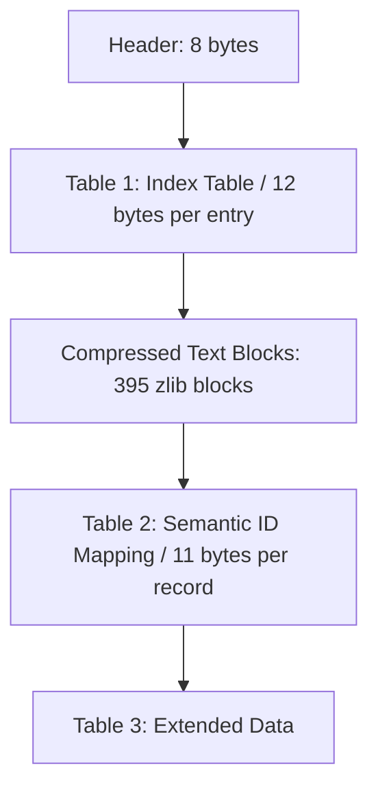

# Fable III (PC) Binary Text & Font Format Documentation

> [!NOTE]
> Bu doküman, Fable III PC sürümünün metin ve font binary yapısını tanımlar. "Kanıtlanmış/Doğrulanmış" ve "Henüz Oyun İçi Doğrulanmamış Hipotez" bölümleri ayrılmıştır.

---

## 1. Genel Mimari ve Karakter Kodlaması
Fable III metin motoru **Big-Endian** tamsayı mimarisi ve **UTF-16BE (Big-Endian Unicode)** metin kodlaması kullanır.

Tüm metin verisi `data/language/<dil>/text/book.babel` dosyası içinde toplanmıştır.

---

## 2. `book.babel` Dosya Mimarisi

### Bölüm 1: Header (8 Bayt) [DOĞRULANDI]
- `0x00 - 0x03`: Dosya Tanımlayıcı (`0x5B010000`).
- `0x04 - 0x07`: `Entry_Count` (uint32_be): Toplam metin kayıt sayısı (İngilizce sürümde `0x00010B57` = 68.439).

### Bölüm 2: Table 1 — Index Table (12 Bayt / Kayıt) [DOĞRULANDI]
Boyut: `Entry_Count * 12` bayt. Her kayıt metnin blok konumunu tanımlar:
- `uint32_be ID`: Metnin benzersiz sayısal kimliği (örn. `0x0002F765`).
- `uint32_be Block_Tag`: Metnin ait olduğu bloğun kimlik etiketi (`w1` ile eşleşir).
- `uint32_be Block_Offset`: İlgili bloğun **açılmış (uncompressed)** verisi içindeki başlangıç bayt offset'i.

### Bölüm 3: Sıkıştırılmış Metin Blokları [DOĞRULANDI]
Index Table'ın hemen ardından gelir:
- `uint32_be Block_Count`: Toplam blok sayısı (İngilizce için `0x0000018B` = 395).
- Ardından 395 adet blok ardışık olarak yer alır:
  - `uint32_be Block_Tag`: Table 1'deki etiketle eşleşen sabit blok anahtarı (örn. `0x60F71E00`). Checksum değildir, diller arasında sabittir.
  - `uint32_be Compressed_Size`: Zlib Deflate sıkıştırılmış veri boyutu.
  - `uint32_be Uncompressed_Size`: Açılmış veri boyutu (~16.384 bayt = 16 KB civarı).
  - `bytes Zlib_Stream`: Seviye 9 raw/Deflate zlib sıkıştırılmış veri akışı (`78 da`).

#### Açılmış Blok İçi Metin Formatı:
- `uint32_be Length`: Karakter sayısı (sonundaki null karakter dahil).
- `UTF-16BE bytes`: Metin içeriği (`Length * 2` bayt). Sonunda `\0` null-terminator bulunur.

> [!NOTE]
> **Blok boyutu (kodla ölçüldü, 395 blok):** Açılmış boyutlar 10.138 – 17.522 bayt, ortalama 16.442. Blokların büyük çoğunluğu 16.384'ü hafifçe aşar (dosya "16384'e ulaşana kadar doldur" mantığıyla yazılmış gibi). Yani 16 KB sabit bir üst sınır değildir; oyun orijinalde zaten 17,5 KB'a kadar blok okuyor. Oyun içi test: 64 KB'a kadar bloklar ve bölünmüş bloklar sorunsuz okunuyor (bkz. bölüm 4).
>
> **Zlib akışları:** Orijinal akışlar `78 da` ile başlar ancak sonlandırılmamıştır (`decompressobj().eof == False`). Python `zlib.compress` kapanışlı akış üretir; Test 1/2'de oyun bunu sorunsuz okudu.
>
> **Blok etiketi (`Block_Tag`):** 395 blokta 395 farklı değer; hepsi 0x100'ün katı. Bölme modunda yeni bloklara `orijinal_etiket + 0x100*k` (kullanılmayan ilk değer) verilir. Oyunun yeni etiketleri kabul edip etmediği `testA4_split` ile test edilir.

### Bölüm 4: Table 2 — Semantik Durum Tablosu (11 Bayt / Kayıt) [DOĞRULANDI]
- `uint32_be Header_Val`: `0x00004000` (16.384).
- `uint32_be Record_Count`: Kayıt sayısı (`0x0000E22C` = 57.900).
- Her kayıt 11 bayttır:
  - `uint32_be ID`: String ID (Table 1 ile eşleşir).
  - `uint32_be Internal_Key`: Lionhead dahili semantik anahtar değeri (İngilizce ve Rusça arasında %100 aynı kalır, içerik hash'i değildir).
  - `bytes[3] Flags`: Durum baytları (örn. `00 00 01`).

### Bölüm 5: Table 3 (Table 2'den sonraki 327.500 bayt) [KODLA DOĞRULANDI: ofset içermiyor]
Table 2 bittikten sonra dosya sonuna kadar 327.500 bayt (4'ün katı) kalır. Kuyruğun tamamı (Table 2 + Table 3) repack sırasında değişmeden kopyalanır. Analiz (4 hizalamanın hepsinde, uint32 BE olarak tarandı):
- Hizalı (offset%4==0) uint32 değerlerinin **67.635 tanesi Table 1'deki string ID'lerine** denk gelir (diğer hizalamalarda 0–5 rastlantısal isabet). Yani Table 3 string ID gruplarından/listelerinden oluşur (ör. `count, id, id...` benzeri; başlangıç: `0xF70, 0x3570E8, 1, 0x3570E8, 0x39FC7B, 0xC, 0x43C9ADC8, ...`).
- **Blok etiketlerinden hiçbiri** (0/395) kuyrukta geçmez. Blok boyutlarıyla ve ofsetlerle yalnızca rastlantısal (küçük sayı) çakışmalar vardır.
- Table 2'deki 57.900 ID'nin tamamı Table 1'de vardır ve benzersizdir.

Sonuç: kuyruk yalnızca string ID'lerine başvurur; blok/ofset/uzunluk değişiklikleri onu etkilemez. (Test 2'de farklı uzunlukta metinler oyunda çalıştı; bu sonucu destekler.) Table 3'ün tam anlamı hâlâ çözülmedi, ancak çeviri için gerekmiyor.

---

## 3. Font Formatı (`.bft` — Binary Font Texture) [DOĞRULANDI]

Oyun içi font `data/language/<dil>/fonts/gui_normal.bft` dosyasıdır. (İngilizce kurulumda tüm oyun için kullanılan tek `.bft` dosyasıdır).

- **Toplam Dosya Boyutu:** 1.071.935 bayt.
- **Doku Boyutu:** **512x512 32-bit (4 bayt/piksel) RGBA Signed Distance Field (SDF)** ham piksel verisi (`512 * 512 * 4 = tam 1.048.576 bayt`).
  - DXT/BC sıkıştırması yoktur, tamamen lineer uncompressed 32-bit veridir.
  - Piksel değerleri glif sınırına olan mesafeyi (SDF gradient) temsil eder (merkez ~118, glif kenarı ~160, arkaplan ~235-240).
  - Her glif dokuda 32x32 hücre içindedir; kenarlarında 0.5 piksel güvenlik payı ve 31x31 glif alanı bulunur.
  - Satır başına 16 glif x 14 dolu satır = **tam 224 glif** (Y: 0 .. 447).
  - **Kullanılmayan Boş Alan:** Satır 14 ve 15 (Y: 448 .. 511) tamamen boştur (32 gliflik boş alan mevcuttur).
- **Header Yapısı (Tam 25 Bayt):**
  - `0x00..04`: `uint32_le version` (3)
  - `0x04..08`: `uint32_le font_size` (23)
  - `0x08..12`: `uint32_le weight` (400 - Normal)
  - `0x12..16`: `uint32_le italic` (0)
  - `0x16`: `uint8 unk_flag` (0)
  - `0x17..21`: `uint32_le field_17` (479 in en-uk, 423 in ru-ru): Latin Unicode kapsama sınırı (`U+01DF` = 479).
  - `0x21..25`: `uint32_le glyph_count`: Glif metrik kaydı sayısı (İngilizce için 224).
- **Glyph Metrik Tablosu (Offset 25..6297):**
  - 224 adet glif kaydı, her biri **28 bayt (7 float-LE)**:
    - `float u0`: Sol doku UV (0.0 .. 1.0)
    - `float v0`: Üst doku UV (0.0 .. 1.0)
    - `float u1`: Sağ doku UV (0.0 .. 1.0)
    - `float v1`: Alt doku UV (0.0 .. 1.0)
    - `float bearingX`: Yatay kaydırma / ofset
    - `float bearingY`: Düşey taban çizgisi ofseti
    - `float advanceX`: Karakter aralık genişliği
- **Unicode Charmap Tablosu (Offset 6297..23267):**
  - `uint32_le entry_count` (6297..6301): 8.483 adet giriş (`U+0000` .. `U+2122`).
  - `uint16_le glyph_index` dizisi (6301..23267):
    - Dizi indeksi doğrudan karakterin Unicode değeridir.
    - Tanımsız/boş karakterler `0xE1E1` ile işaretlidir.
- **Doku Başlığı / Metadata Tanımlayıcı (Offset 23267..23359):**
  - Genişlik: `0x00000200` (512)
  - Yükseklik: `0x00000200` (512)
  - Bayt / Piksel: `0x00000004` (4 bayt)
  - Veri boyutu: `0x00100000` (1.048.576 bayt)
- **Ham Doku Verisi (Offset 23359..1071935):**
  - Son 1.048.576 baytlık 512x512 RGBA SDF piksel akışı.

---

## 4. Oyun içi doğrulanmış / bekleyen sonuçlar
- DOĞRULANDI: `TR_` ön eki (tüm metinler), farklı uzunlukta metinler, font yaması 4c (ğĞşŞıİ).
- ÇALIŞMIYOR: `patch_text` klasörü yolu.
- DOĞRULANDI: `testA1_20k` (20 KB), `testA2_32k`, `testA3_64k` blokları oyunda okunuyor; `testA4_split` (bölünmüş blok + yeni blok etiketleri) okunuyor. Çökme yok.
- `testB_blockmark`: blok → içerik haritası için bkz. `docs/BLOCK_MAP.md`.
- Test 3'ün eski sonucu (kayıt görünmedi) **geçersiz sayılır**: o test yalnızca "New Game" metninin 2 kopyasından birini değiştirmişti; menü diğer kopyayı kullanmış olabilir. Yeni testler tüm kopyaları değiştirir.
